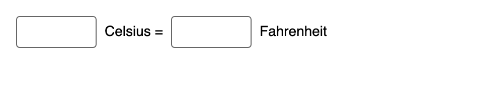
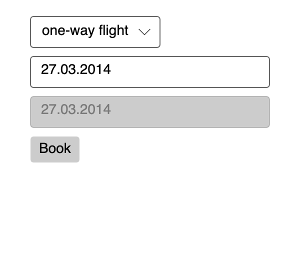
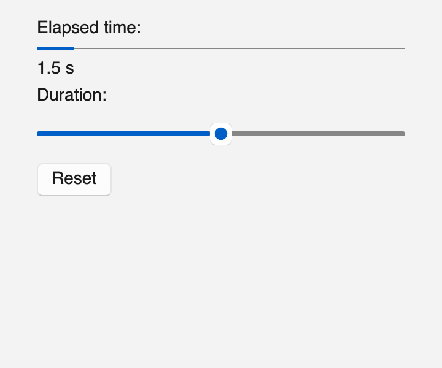
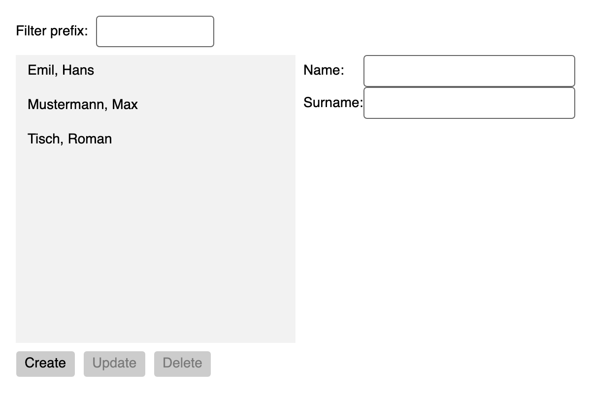
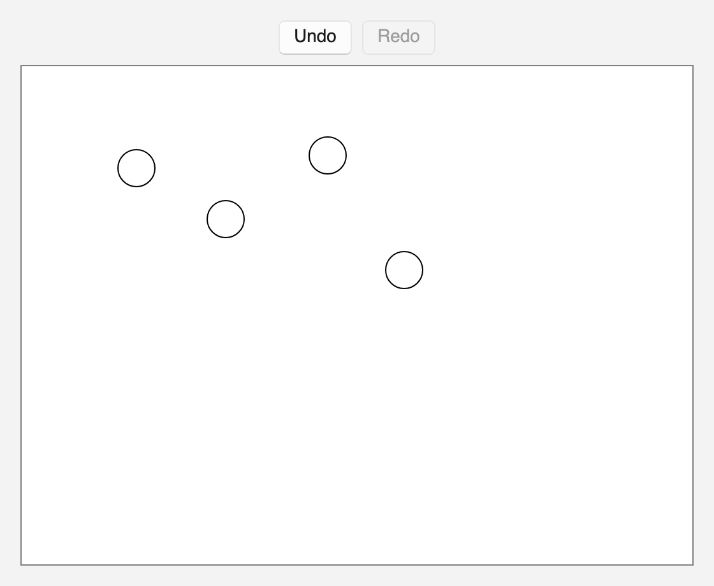
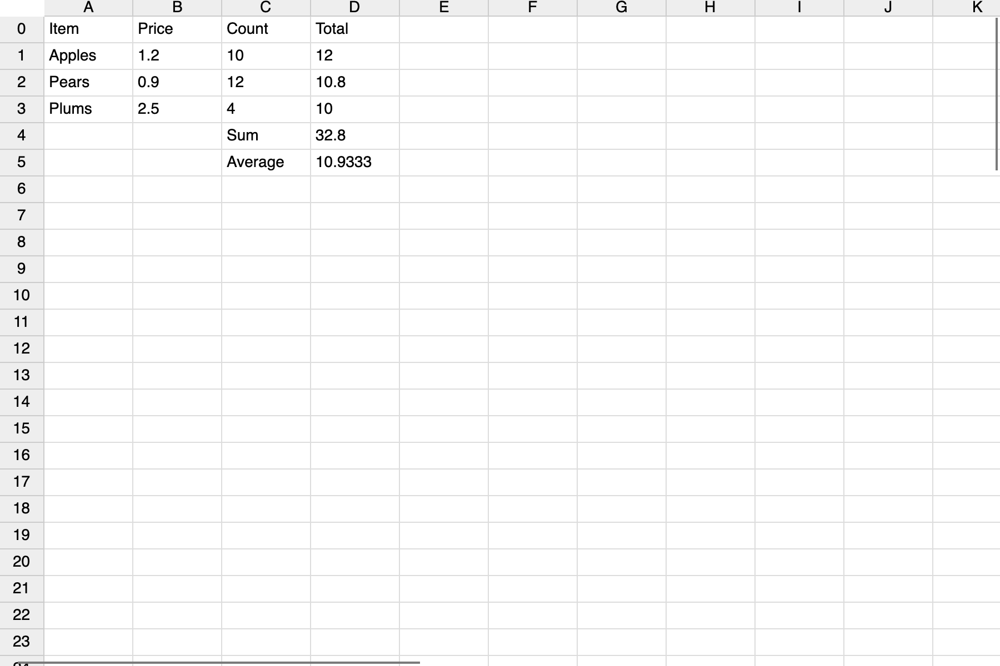

# Declarative user interfaces in Rust (`ferroui-view`)

FerroUI user interfaces can be written in Rust without XAML: elements built with chained setters or with the `rsx!` macro, state held in signals that the properties of controls follow, and children that follow state. The controls, themes, layout, styles and bindings are the ones XAML and imperative Rust use; this is another way to create and connect them.

This document is the design of the crates and the plan of the work (issue #237). Phase 0, described here, is built: the element tree, the builders, the macros, the reactivity and the 7GUIs samples. A later phase adds a reconciler that compares element trees (section 8).

## 1. A first look

The counter of 7GUIs with the builders:

```rust
use ferroui_view::prelude::*;

pub fn counter() -> Element {
    let count = signal(0);
    stack_panel()
        .orientation(Orientation::Horizontal)
        .spacing(8.0)
        .child(text_box().text(count).is_read_only(true).width(80.0))
        .child(button().content("Count").on_click(move |_| count.update(|c| *c += 1)))
        .into()
}
```

The same with the macro:

```rust
#[component]
pub fn Counter() -> Element {
    let count = signal(0);
    rsx! {
        StackPanel { orientation: Orientation::Horizontal, spacing: 8.0,
            TextBox { text: count, is_read_only: true, width: 80.0 }
            Button { on_click: move |_| count.update(|c| *c += 1), "Count" }
        }
    }
}
```

An application whose main window is an element (`ferroui-view` with its feature `desktop`):

```rust
fn main() {
    ferroui_view::launch(|| rsx! { Window { title: "Counter", width: 320.0, height: 120.0, Counter {} } });
}
```

## 2. The crates

| Crate | What it holds |
|---|---|
| `ferroui-view` (`src/FerroUI.View`) | The element tree and its mounting, the reactive runtime, the builders (generated), the conversions of values, children that follow state, and with the feature `desktop` the launch of an application |
| `ferroui-view-macros` (`src/FerroUI.View.Macros`) | `rsx!` and `#[component]` |

`ferroui-view` depends on `ferroui-base` and `ferroui-controls`; it adds nothing to them. The builders are generated from their sources by `scripts/generate_view_builders.py`, so a control or a property ported later gets its builder by running the script again (`--check` fails when the generated file is stale; `--report` lists what was left out and why).

## 3. Elements

An `Element` describes user interface: a control with its property values, handlers and children, text, several elements, children that follow state, or a control that exists already (a XAML user control, a control the application keeps).

The element of a control is data:

- the class (how to create the control, compared by type);
- the key among its siblings;
- the `Name` and the style classes;
- the property values: a list of the property (`&'static FerroProperty`) and its value, where a plain value is a `BoxedValue` that compares by value;
- the handlers;
- the children.

`Element::mount` creates the controls: each control is created, told that it is being initialised (`begin_init`, as the XAML loader does, so that an items control applies a selected index once its items are there), given its values, handlers and children, and initialised (`end_init`). Children go into the content of the control: `Children` of a panel, `Items` of an items control, `Content` of a content control, `Child` of a decorator, the text of a `TextBlock`. Text is text where the content takes text (a content, an item) and a `TextBlock` elsewhere.

Because the element of a control is data compared by value, a later reconciler can compare two trees of elements and patch the controls of the first into the second (section 8).

## 4. Builders

For every class of `FerroUI.Base` and `FerroUI.Controls` the generator writes:

- a function that starts an element of a class that can be created (`button()`, `stack_panel()`, 134 of them);
- a trait of the class (`ButtonProps`) with a setter per registered property (`click_mode(..)`) and a handler per routed event (`on_click(..)`), implemented for the element of the class and of every class derived from it (193 traits);
- one trait with a setter per attached property, named after its owner (`grid_row(..)`, `dock_panel_dock(..)`), and the setter on the owner class itself (`scroll_viewer().horizontal_scroll_bar_visibility(..)`).

The element also has its own methods:

| Method | What it does |
|---|---|
| `key(..)`, `name(..)`, `class("a b")` | The key, the `Name`, style classes |
| `child(..)`, `children((a, b, c))` | Children: elements, builders, text, vectors, arrays, tuples |
| `set(property, value)` | Any property, also one the generator left out or one of another crate |
| `bind(property, binding)` | A binding of the property system (`Binding`, a path on the data context) |
| `on(event, handler)` | Any routed event, with the control that handles it |
| `on_changed(property, handler)` | The new value of a property whenever it changes |
| `with(|control| ..)` | The control once it was made (a call the class has no property for) |
| `node_ref(r)` | Keeps the control in a `NodeRef` |
| `row_definitions("Auto,*")`, `column_definitions(..)` | The rows and columns of a grid, as XAML writes them |

### 4.1 What a setter takes

A setter of a property whose value is `T` takes what converts to it (`IntoProp<T, _>`, the second parameter inferred):

| Given | The property |
|---|---|
| a `T`, or a value that converts to `T` (below) | is set once |
| a `Signal<V>` or a `Memo<V>` | follows it |
| a closure `move \|\| ..` | follows what the closure reads |
| `signal.two_way()` | follows the signal, and a change of the property (the user typed, a slider moved) is written into the signal |
| `Bind(binding)` | is bound by the property system |
| an element, for a property that holds an object (`content`, `header`, `tag`) | holds its control |

The conversions of values: `T` to `Option<T>`; text to `String` and `Option<String>`; numbers to `f64` and to text; `f64` and tuples to `Thickness`; `f64` to `CornerRadius`; a `Color`, a color name or `#rgb` text to a brush.

### 4.2 The forms of upstream's code-first API

Upstream writes properties and bindings in code with indexers and operators on properties. Rust has neither an assignable indexer nor a second prefix operator (the port already maps `!Property` to `Property.bind()`, see the waivers of `AvaloniaProperty`), so the element has methods for them:

| Upstream C# | Here |
|---|---|
| `control[Grid.RowProperty] = 1` | `.set(Grid::row_property(), 1)` or `.grid_row(1)`; in `rsx!`, `Grid.row: 1` |
| `control[!TextBlock.TextProperty] = binding` | `.bind(TextBlock::text_property(), binding)` |
| `control.Bind(Property, observable)` | `.text(signal)`, `.text(move \|\| ..)` |
| `!!` (two-way) | `.text(signal.two_way())` |
| `control.Classes.Add("accent")` | `.class("accent")` |
| `new Style(x => x.OfType<Button>())` | the styles API of the port (`Selectors`, `Style`, `Setter`), unchanged |

## 5. The macros

### 5.1 `rsx!`

```rust
rsx! {
    Grid { row_definitions: "Auto,*", column_definitions: "*,Auto",
        TextBox { Grid.row: 0, text: draft.two_way() }
        Button { Grid.column: 1, class: "accent", on_click: add, "Add" }
        ListBox { Grid.row: 1, { for_each(move || todos.get(), |t| t.id, |t| rsx! { ListBoxItem { content: t.title } }) } }
    }
}
```

| Form | Meaning |
|---|---|
| `Name { .. }` | An element of the class or component `Name` in scope: `<Name as Builder>::builder()`. The prelude names every control class; a component declares its own type |
| `name: value` | The setter `.name(value)`: a property, a handler, `key`, `name`, `class` |
| `name` | The setter `.name(name)`, as a field of a struct is given |
| `Owner.name: value` | An attached property: `.owner_name(value)` (`Grid.row`, `DockPanel.dock`, `Canvas.left`) |
| `name(a, b)` | A method with several arguments: `on_changed(property, handler)`, `set(property, value)`, `bind(..)`, `with(..)` |
| `"text"`, `{expr}`, a nested element | Children |
| `if cond { .. } else { .. }`, `for x in items { .. }` | Children chosen or repeated when the tree is built |

An attribute a class has no setter for is a missing method of its builder: the error points at the attribute.

### 5.2 `#[component]`

```rust
#[component]
fn Labelled(label: String, #[prop(default = 2)] digits: usize, value: f64) -> Element { .. }

rsx! { Labelled { label: "Sum", value: total } }     // or labelled().label("Sum").value(total)
```

The function stays as it is. Beside it the macro declares a type of the name (what `rsx!` names), a builder function in snake case (`labelled()`) with a setter per parameter taking what converts into its type, and the key. A parameter is required unless it has `#[prop(default)]`, `#[prop(default = expr)]` or an `Option` type; a missing one panics with its name when the element is built. A parameter `children: Element` takes the children of the element. A component runs once, when its element is built.

## 6. State

`signal(value)`, `memo(|previous| ..)` and `effect(|| ..)` are fine-grained reactivity: an effect records the signals and memos it reads and runs again when one of them changes; a memo is a value computed the same way and read like a signal. Handles are `Copy`, so a `move` closure takes them without a clone.

Every signal, memo and effect belongs to the `Owner` that was current when it was made, and is disposed with it: a mounted tree has an owner (`Element::mount_root`, a window mounted by `launch` or `open_window` ends it when the window closes), each item of a dynamic list has its own, and an effect owns what it makes while it runs. `on_cleanup` runs code when the owner ends (a timer stopped, a subscription disposed). Using a handle after its owner ended panics. `batch` runs the effects once after several writes; `untrack` reads without following.

### 6.1 Children that follow state

| Function | Children |
|---|---|
| `for_each(each, key, view)` | One per item, kept by key: an item whose key and value stay keeps its control; a new or changed item gets a new one; the controls of items that left are taken out |
| `show(when, then)`, `show_else(when, then, otherwise)` | The children of the branch, made again only when the condition changes |
| `dynamic(render)` | Whatever the closure gives, made again when what it read changes; an element with a key keeps its control |

They are elements a parent mounts in place, among its other children, in panels, items controls and contents.

## 7. Samples: 7GUIs

The seven tasks of 7GUIs (<https://eugenkiss.github.io/7guis/tasks>) are written twice, once with the builders and once with `rsx!`, each task a crate of its own so that each stays small:

| Task | Builders | Macro |
|---|---|---|
| Counter | `samples/SevenGuis/Builders/Counter` | `samples/SevenGuis/Macros/Counter` |
| Temperature converter | `.../Builders/Temperature` | `.../Macros/Temperature` |
| Flight booker | `.../Builders/FlightBooker` | `.../Macros/FlightBooker` |
| Timer | `.../Builders/Timer` | `.../Macros/Timer` |
| CRUD | `.../Builders/Crud` | `.../Macros/Crud` |
| Circle drawer | `.../Builders/CircleDrawer` | `.../Macros/CircleDrawer` |
| Cells | `.../Builders/Cells` | `.../Macros/Cells` |

`samples/SevenGuis/Model` holds what the two share: the conversions, the dates, the CRUD filter, the circle history, the formulas of the cells (a parser and an evaluator; each cell is a memo of the cells it names, so a change is computed again only in the cells that depend on it, and a cycle is an error until it is broken), the reactive state of the circle drawer and of the cells, and the window a task runs in. `samples/SevenGuis/Tests` runs one scenario per task on each of the fourteen crates (what a user types and clicks, and what the task must show), in one test binary.

The windows of the tasks, as each renders itself (`FERROUI_SEVEN_GUIS_SHOTS`); the two versions of a task render the same pixels:

| Counter | Temperature converter | Flight booker |
|---|---|---|
|  |  |  |

| Timer | CRUD |
|---|---|
|  |  |

| Circle drawer | Cells |
|---|---|
|  |  |

```sh
cargo run -p seven-guis-counter-builders
cargo run -p seven-guis-cells-macros
FERROUI_SEVEN_GUIS_SHOTS=/tmp/shots cargo run -p seven-guis-crud-macros   # renders the window into /tmp/shots/macros-crud.png
```

## 8. Next phases

**Reconciler.** Phase 0 runs a component once and changes controls through signals. The element tree is built so that a component can also run again and return a new tree, which a reconciler compares with the previous one:

1. the same class at the same place (or the same key among siblings) keeps its control; another class replaces it;
2. property values that are equal are left alone; values that changed are set; values that are gone are cleared (`clear_value_untyped`); reactive values are bound again;
3. handlers are attached again (closures are never equal);
4. children are compared by key, then by place, as `for_each` already does for its items.

What is needed for it: a component element (the props and the function, kept with the element instead of called at once), hooks with slots by call order (`use_state`, `use_memo`, `use_effect`) for a component that runs again, and the patch operations above. The two models can live together: a component that runs once (signals) and one that runs again (hooks) produce the same elements.

**Other work.** Hosting a component in XAML (a `ComponentHost` control) and XAML in a component (`Element::Existing` already takes any control); hot reload of the static parts of `rsx!`; builders for the controls of other crates (TreeDataGrid, the color picker) from the same generator; a `Style` builder in the form of the element builders.

## 9. Testing

- `src/FerroUI.View/tests`: the reactive runtime, setters and conversions, mounting, two-way values, handlers, keyed lists, conditions, the macros and components.
- `samples/SevenGuis/Tests`: the scenarios of the seven tasks on the fourteen crates, on the test application of `ferroui-controls` (a dispatcher of the thread).
- `samples/SevenGuis/Model`: the logic without user interface.
