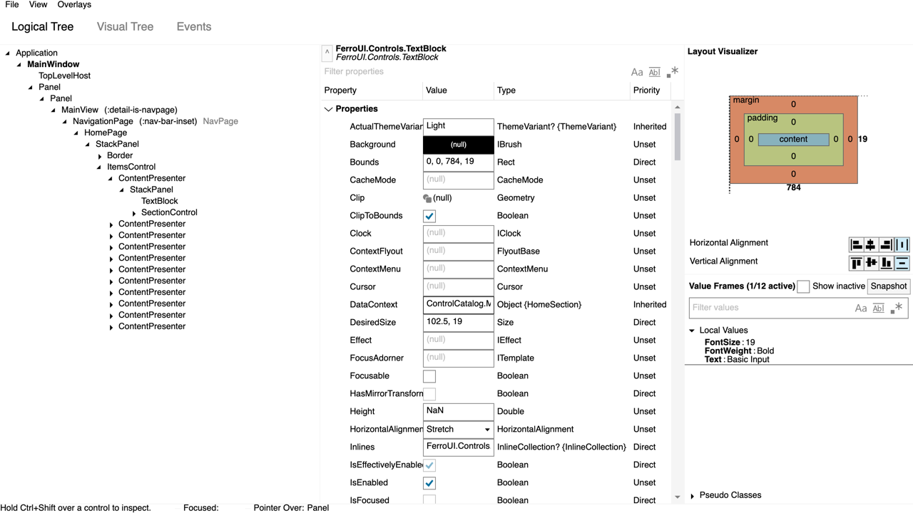
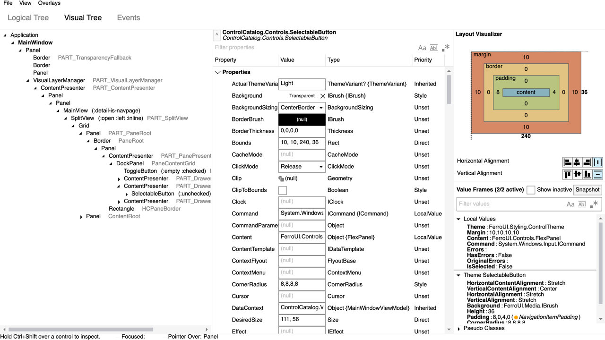
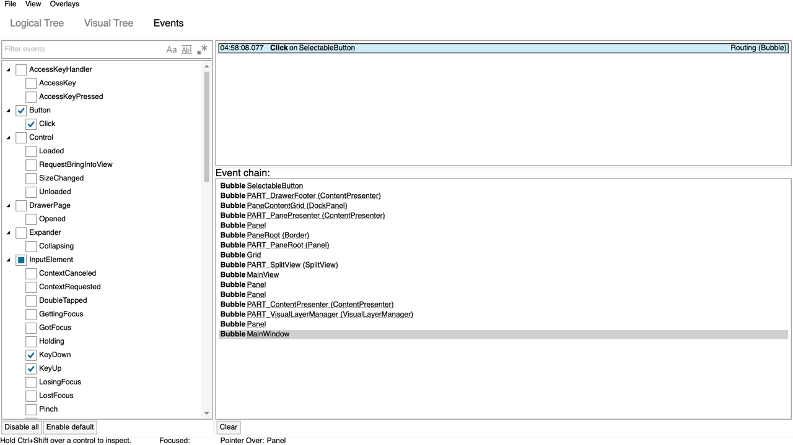

# Developer tools port

The port of upstream's developer tools, `src/Avalonia.Diagnostics`, as the crate `ferroui-diagnostics` (`src/FerroUI.Diagnostics`). Upstream removed the project in `71ce62ae32` (#20332, 2026-01-07) in favour of a commercial product; the port is of its last open-source version, the parent of that commit (`4af92dcce2`, 2026-01-06), read from the reference checkout at `/Users/wieslawsoltes/GitHub/Avalonia`.



## 1. What the reference contains

| Part | C# files | Documents | Role |
|---|---|---|---|
| `DevToolsExtensions.cs` and `Diagnostics/` (top level) | 1 + 13 | | `AttachDevTools` on a top level and on an application; `DevTools` (attach, open, the key gestures), `DevToolsOptions`, the top-level groups of a window, a single view and a desktop lifetime, the hot keys, the data formats, the view locator, extensions of visuals and types |
| `Behaviors/`, `Controls/`, `Converters/` | 1 + 7 + 5 | 3 | The column width behaviour; the brush and thickness editors, the commit and filter text boxes, the highlight adorner; the converters of the views |
| `Models/`, `Screenshots/` | 1 + 2 | | The links of the route of an event; the screenshot handlers (a PNG of the selected control through a file picker) |
| `ViewModels/` | 25 | | The tree pages (logical and visual nodes, the filter with regular expressions), the control details (properties, value frames and their setters, pseudo-classes, the layout), the events page (the registered routed events by owner, the recorded events with their route), the hot keys, the main view model |
| `Views/` | 8 | 7 | The main window and view, the tree page, the control details, the layout explorer, the property value editor, the events and hot keys pages |
| `Assets/` | | 1 | The icons; the Source Sans Pro font |
| All | 63 (6,267 lines) | 11 (1,352 lines) | |

The property grid of the control details is a `DataGrid` that the project compiled from the DataGrid submodule (`external/Avalonia.Controls.DataGrid`), which the same upstream commit removed.

## 2. Crate and places

| Reference | Port | Path |
|---|---|---|
| `Avalonia.Diagnostics` | `ferroui-diagnostics` (75 Rust files, 12,700 lines; 11 compiled markup documents) | `src/FerroUI.Diagnostics` |
| The namespaces `Avalonia.Diagnostics.*` | the modules `diagnostics::{behaviors, controls, converters, models, screenshots, view_models, views}`; the markup namespaces are `FerroUI.Diagnostics.*` | |
| The markup documents next to their code-behind | the documents next to the Rust file of their class (`diagnostics/views/MainWindow.xaml` beside `main_window.rs`), compiled by the build script of the crate | |
| `DevToolsExtensions` (namespace `Avalonia`) | `DevToolsExtensions` and `DevToolsTopLevelExtensions` at the root of the crate | `dev_tools_extensions.rs` |
| The attach call of the ControlCatalog (`AfterSetup`, `StartupScreenIndex = 1`) | `attach_dev_tools` of the desktop entry point, in debug builds | `samples/ControlCatalog.Desktop/program.rs` |
| The facade | the optional feature `diagnostics` of `ferroui` (`ferroui::diagnostics`) | `src/FerroUI` |
| Unit tests (none upstream) | `tests/{core,tree,details,events}_tests.rs`, 67 tests | `src/FerroUI.Diagnostics/tests` |

## 3. Decisions

1. **The TreeDataGrid in place of DataGrid.** The owner's decision: the property grid is the `TreeDataGrid` of the port (`ferroui-controls-treedatagrid`), not a port of DataGrid. `PropertiesView` takes the place of the `DataGridCollectionView` the view model built: the same groups (Pinned, Properties, Attached Properties, CLR Properties, Unset), the same order (`PropertyComparer`) and the same filter. The groups are the root rows of a `HierarchicalTreeDataGridSource<PropertiesViewItem>`; the columns are made in code: Property (with the expander and the pin), Value (the `PropertyValueEditorView` of upstream), Type, Assigned Type and Property Type (shown by `ShowDetailsPropertyType`, as upstream), and Priority. A click on a column header sorts within the groups. The selection of the grid and the selected property of the view model follow each other; the groups the user collapses stay collapsed when the properties are refreshed; `ScrollIntoView` is `bring_into_view` of the row. `RowBackground` of the DataGrid has no counterpart.
2. **Compiled markup.** The eleven documents are compiled by the build script of the crate (`build.rs`, as the themes and the dialogs), with compiled bindings by default as upstream's project; each document is a group of its own, and the documents that include others (`ResourceInclude Source="/Assets/Icons.xaml"`) are compiled with all of them. The theme of the window is the simple theme, as upstream's; the theme of the grid is the TreeDataGrid's `Themes/Generic.xaml`.
3. **Extension pages (an addition).** A crate can add a page to the developer tools: `MainViewModel::register_page(DevToolsPage::new(title, |main| -> Ref<Control>))` returns a handle whose disposal removes the page; the windows opened afterwards on the thread show a tab for each registered page after the four of upstream (`MainViewModel::FIRST_EXTENSION_TAB`). The components page of `ferroui-view` is meant to use it.
4. **Model types.** The view models are `Rc` types with markup metadata (`ferro_markup_type!`); the abstract classes with two derived classes become a shared base and an enum handle that dispatches (`PropertyViewModelRef` over `FerroPropertyViewModel` and `ClrPropertyViewModel`, `SetterViewModelRef` over the setter kinds); the logical and the visual tree nodes are one `TreeNode` with a `TreeNodeKind`. The port-status scan counts these members in their new places as waived, with the reason (`docs/porting/data/diagnostics/member-waivers.toml`).
5. **Regular expressions.** The filters use the `regex` crate in place of the regular expressions of .NET: the syntax both share behaves the same; what only .NET has (lookarounds, backreferences) does not parse and is shown as an error of the filter.
6. **Text box placeholders.** Upstream's documents set `Watermark` on the filter boxes; the port's `TextBox` keeps `Watermark` only as a deprecated alias of `PlaceholderText` that markup does not see, so the documents set `PlaceholderText`, the same property.

What differs from upstream in behaviour or form is in `DEVIATIONS.md`, section "Developer tools".

## 4. Changes to the framework for the port

- **Markup compiler:** a setter of a style class in a style (`<Setter Property="Classes.handled" Value=".."/>`) compiles: the emitter writes the property of the class as `rt::class_property(name)` (`StyledElementExtensions.GetClassProperty`); it had no rule for that node (`FRN3000`). The corpus document `class_setter.xaml` of the emitter's differential harness covers it.
- **Markup metadata:** `Window.Close()` is a method markup can call (`$parent[Window].Close` of the main view), in `scripts/markup_types_overrides.py`.
- **Markup `Binding`:** `BindingBase::as_any` returns the binding itself, as the extensions of the markup crate do, so that the value frames tell a reflection binding held as `Rc<dyn BindingBase>` apart.

## 5. Verification

- **Unit tests** (`cargo test -p ferroui-diagnostics`): the key gestures and the attach of a top level, the converters and the view locator; the tree pages, the filter and the selector of a visual; the property grid (groups, sorting, filtering, pinning, selection), the value frames and their setters, the layout view model; the events tree, the recording of an enabled event with its route, the hot keys and the extension pages.
- **The ControlCatalog on macOS** (debug build, Metal): F12 pressed on the catalog window opens the developer tools window; with real input the logical tree expands, a click selects a node and fills the property grid, the layout visualizer and the value frames; typing in the filter of the properties filters them; editing the `Title` of the main window in the grid renames the catalog window; a click on the header Priority sorts each group (Direct, LocalValue, Unset).
- **A smoke run** of the catalog does the same steps without a person and writes a picture of the developer tools window after each of them:

  ```text
  FERROUI_SMOKE_DEVTOOLS=/tmp/devtools cargo run -p control-catalog-desktop
  ```

  F12 goes to the input manager as the platform passes a key; the run selects a text block in the logical tree, records the click of a button on the events page, goes from there to the button in the visual tree (as a double tap on a link of the route does), and shows the hot keys.





## 6. Port status

`scripts/port-status/run.sh --reference diagnostics` (extraction at the tracked commit: `TRACKED_COMMIT=71ce62ae32~1 UPSTREAM=<checkout> scripts/port-status/run.sh --reference diagnostics`) writes `docs/porting/tracking/diagnostics/`: 63 of 63 files, 70 of 70 types, 390 of 430 members found and 40 waived (each a member ported in another place, section 3.4), 100%.
