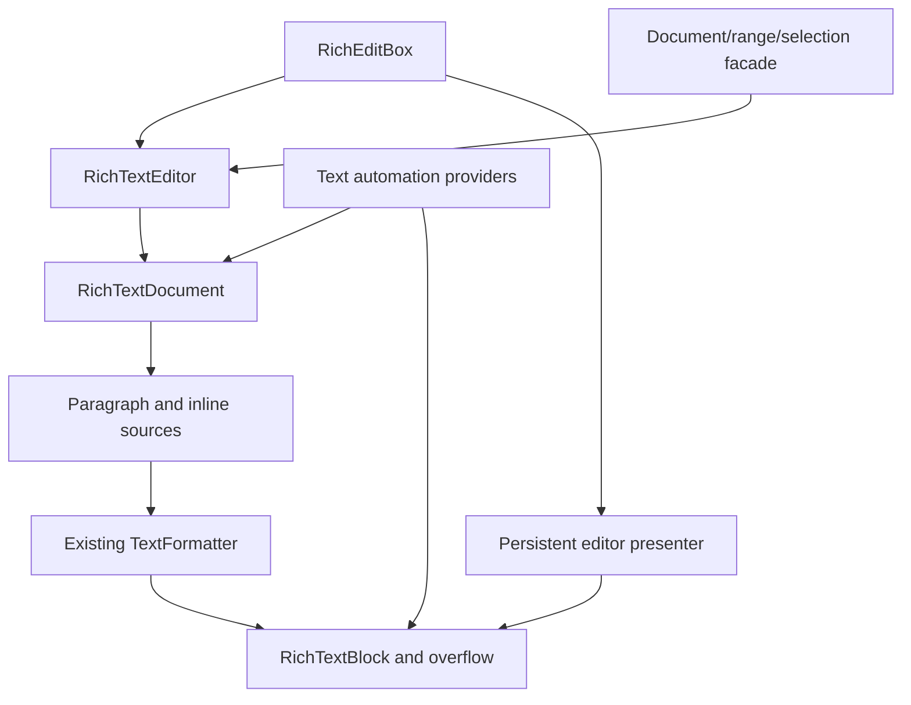

# Using and extending the rich text implementation

The implementation uses FerroUI's existing object, property, document-inline,
text-formatting, input, clipboard, dispatcher and automation contracts. This guide
describes the implemented architecture and its public Rust entry points. The
exact upstream member dispositions are in [API-MAP.md](API-MAP.md); missing native
members remain pending there and in [DEVIATIONS.md](DEVIATIONS.md).

## Architecture and ownership



| Responsibility | FerroUI contract and implementation |
|---|---|
| Observable objects, inherited values, untyped markup | `Ref<T>`, `FerroObject`, `ferro_class!`, registered properties and ordinary markup metadata. |
| Document identity and structure | [RichTextDocument](../../../src/FerroUI.Controls/documents/rich_text_document.rs), shared BlockCollection/InlineCollection handles and existing Run/Span/Bold/Italic/Underline/LineBreak/InlineUIContainer types. |
| Durable edit state | [DocumentSnapshot](../../../src/FerroUI.Controls/documents/document_snapshot.rs) and [format patches](../../../src/FerroUI.Controls/documents/character_format.rs). Mutable feature/decoration values are copied when snapshots are taken. |
| Shaping and line layout | [RichTextSource/RichTextLayout](../../../src/FerroUI.Controls/rich_text_layout.rs) feed the existing formatter. Existing font selection, Unicode, bidi, shaping, glyph drawing and text-run APIs remain responsible for text layout. |
| Pagination and selection | [RichTextBlock](../../../src/FerroUI.Controls/rich_text_block.rs) owns a primary view; [RichTextBlockOverflow](../../../src/FerroUI.Controls/rich_text_block_overflow.rs) contributes further pages through weak links. |
| Editable state | [RichTextEditor](../../../src/FerroUI.Controls/rich_text/rich_text_editor.rs) owns history, selection, typing format, input limits and composition state over the same model. |
| Control integration | [RichEditBox](../../../src/FerroUI.Controls/rich_edit_box.rs) derives from TemplatedControl and owns one persistent [RichEditBoxTextPresenter](../../../src/FerroUI.Controls/rich_edit_box_text_presenter.rs). It connects owner-routed input, clipboard, caret and the [input-method client](../../../src/FerroUI.Controls/rich_edit_box_text_input_method_client.rs). |
| Native text-object semantic services | [RichEditTextDocument/Range/Selection](../../../src/FerroUI.Controls/rich_text/rich_edit_text_document.rs) expose typed operations over the same editor; this is separate from the unavailable native TOM ABI. |
| Accessibility | [Portable text providers](../../../src/FerroUI.Controls/automation/provider/i_text_provider.rs) and [range providers](../../../src/FerroUI.Controls/automation/provider/i_text_range_provider.rs) use the same document/geometry; the [Windows bridge](../../../src/Windows/FerroUI.Win32/automation/automation_node_text.rs) handles native marshalling. |

The primary view owns the logical content. Overflow links and back references are
weak, and linking rejects cycles or a second owner. A model cannot be attached to
two unrelated primary views at once. For independent views, create independent
models from a snapshot. An embedded control is still the same control in that
snapshot, so copying it does not make simultaneous visual ownership valid.

Formatting and editing callbacks copy values out of interior mutable storage
before raising notifications. Document batches collect changes into a revision;
live pointers follow each completed replacement immediately through an internal
position notification, and public subscribers receive ordered batched notifications.
Pointers created midway through a batch track only subsequent edits, so ending
the batch cannot apply an earlier edit to them twice. The tests for these boundaries are in
[rich_text_document_tests.rs](../../../src/FerroUI.Controls/documents/rich_text_document_tests.rs).

Inherited presentation changes rebuild formatted text without changing the stored
document's revision or composition identity. The property system reports explicit
inheritance provenance because clearing a local value can also produce a value
with inherited priority. `TextElement`, `Inline`, `Block` and `Paragraph` use that
provenance to choose `IInlineHost::invalidate_layout`; the block collection forwards
it to the view without publishing a document edit. Local document formatting still
publishes semantic invalidation, including inside an open edit batch. Inherited
mutable feature and decoration collections take the same layout-only route;
locally assigned collections remain document formatting. Snapshots capture base
values rather than flattening parent presentation, so undo restores content that
continues to inherit the current theme. See RT-I14 and
[presentation invalidation tests](../../../src/FerroUI.Controls/documents/rich_presentation_invalidation_tests.rs).

## Construct a rich document

```rust
use ferroui_base::media::FontWeight;
use ferroui_controls::RichTextBlock;
use ferroui_controls::documents::{Hyperlink, Paragraph, Run, Span};

let view = RichTextBlock::new();
let paragraph = Paragraph::new();
paragraph.inlines().add(Run::with_text(Some("Read ")));

let emphasis = Span::new();
emphasis.set_font_weight(FontWeight::Bold);
emphasis.inlines().add(Run::with_text(Some("formatted text")));
paragraph.inlines().add(emphasis);
paragraph.inlines().add(Run::with_text(Some(" and ")));
paragraph.inlines().add(Hyperlink::with_text(
    "open the project",
    Some("https://github.com/wieslawsoltes/FerroUI"),
));
view.blocks().add(paragraph);
```

Collections are shared handles. Keeping `let blocks = view.blocks()` and adding
to `blocks` changes the view's document; it does not mutate a detached copy.
Block/paragraph and inline ownership is validated during document operations.
Use `InlineUIContainer::with_child(control)` for an embedded control. The control
participates in ordinary FerroUI measure/arrange and is represented by one object
replacement character in the text coordinate system.

The ordinary document classes are registered for XAML. Content remains a
structured document rather than being converted to plain text by the loader:

```xml
<RichTextBlock FontSize="18" TextWrapping="Wrap">
  <Paragraph>
    A <Bold>formatted</Bold> paragraph with
    <Hyperlink NavigateUri="https://github.com/wieslawsoltes/FerroUI">a link</Hyperlink>.
  </Paragraph>
  <Paragraph>Another paragraph.</Paragraph>
</RichTextBlock>
```

The loader's normal whitespace rules still apply. Put intentional spaces in the
text and use adjacent tags when testing structure independently of whitespace.
The implementation does not bypass the regular runtime/compiled markup system.

## Linked columns and page geometry

```xml
<Grid ColumnDefinitions="*,*" ColumnSpacing="20">
  <RichTextBlock x:Name="FirstColumn"
                 Height="240"
                 TextWrapping="Wrap"
                 OverflowContentTarget="{Binding #SecondColumn}">
    <Paragraph>Content is laid out into the first column and continues in the next.</Paragraph>
  </RichTextBlock>
  <RichTextBlockOverflow x:Name="SecondColumn" Grid.Column="1" Height="240" />
</Grid>
```

Continuation includes the formatter break state. The existing
[TextLineBreak::fork](../../../src/FerroUI.Base/media/text_formatting/text_line_break.rs)
preserves the resolved shaping/bidi continuation when a following column has a
different width. Changes to text, formatting, width or an overflow target rebuild
the affected page inputs; selection remains associated with document offsets.

`hit_test_text_position`, `get_rects_for_range`, `line_metrics`, `content_start`,
`content_end` and `text_view_for_position` expose the same formatted view used for
drawing. Querying geometry does not change the selection. Geometry needs measured
and arranged content; the portable automation layer reports an explicit error
when no usable visual geometry exists.

Native line breaking, pixel output, every formatting option and all incremental
cache behavior are separate conformance targets. Reusing the formatter avoids a
second text engine, but does not prove identical native engine output.

## UTF-16 coordinates and live ranges

Public rich document positions count UTF-16 text. For `a😀b`, scalar boundaries
are `0`, `1`, `3`, and `4`. An edit at offset `2` would split the surrogate pair
and is rejected. Paragraph boundaries contribute LF; inline controls contribute
U+FFFC. Native synthetic element-open/close markers are not exposed as text.

`TextPointer` holds a weak document reference and an offset/gravity pair. Gravity
determines whether an insertion at that offset leaves the pointer before or after
the inserted text. Batched edits preserve the order of each position adjustment.
Detached/dropped documents make weak pointers unavailable. TextPointer character
rectangles are shaped insertion/caret rectangles using the requested direction as
affinity, which is an explicit adaptation of native structural geometry.

`RichEditTextRange::get_clone()` creates an independent live range. A range
operation changes that range; selecting it is a separate operation. A selection
is directed, with anchor and active endpoints, while a content range is normalized
for slicing and replacement.

## Text highlighters

Highlighters describe visual ranges without changing the document's formatting
or edit revision. `TextHighlighter` owns solid foreground/background brush values
and a shared range collection. The Rust range value is `TextHighlightRange`;
its markup name remains `TextRange`.

```rust
use ferroui_base::media::Brushes;
use ferroui_controls::documents::{TextHighlighter, TextHighlightRange};

let highlight = TextHighlighter::new();
highlight.set_background(Some(Brushes::yellow()))?;
highlight.ranges().add(TextHighlightRange::new(0, 5));
view.text_highlighters().add(highlight);
```

```xml
<RichTextBlock.TextHighlighters>
  <TextHighlighter Foreground="Black" Background="#FFFFDB80">
    <TextRange StartIndex="0" Length="10" />
  </TextHighlighter>
</RichTextBlock.TextHighlighters>
```

StartIndex and Length preserve signed source values. Inserting a range into the
collection copies that value; modifying a retrieved copy requires writing it back
through `set` to change the collection. Markup uses a temporary boxed value while
assigning the two fields, then copies it into the collection. Empty/invalid ranges
do not paint, and valid regions are clipped to the document.

Later highlighter layers replace both foreground and background with their own
brushes/defaults. Visual normalization occurs per layer before overlap resolution
so scalar boundaries do not change precedence or rewrite the public range value.
Brush/item changes invalidate the visual input through weak subscriptions.
The literal source overlap fixtures and value/lifetime tests are linked in
[TESTS.md](TESTS.md); native rendering and high-contrast conformance remain distinct.

## Editing and text-object services

```rust
use ferroui_base::media::FontWeight;
use ferroui_controls::RichEditBox;
use ferroui_controls::documents::CharacterFormat;

let editor = RichEditBox::new();
editor.set_text("Hello, rich text")?;
let text = editor.text_document();

text.edit_group(|text| {
    let word = text.get_range(0, 5)?;
    word.set_character_format(&CharacterFormat {
        font_weight: Some(FontWeight::Bold),
        ..Default::default()
    })?;
    word.set_text("Welcome")
})?;

text.undo()?;
```

`RichEditBox::document()` is the control's direct shared-model property.
`RichEditBox::text_document()` is the editing/service facade. Both use the same
document, selection, geometry and history. This naming distinction avoids
introducing a second editable model behind the control.

The editor enforces read-only and UTF-16 maximum-length policies, performs
grapheme-aware deletion, coalesces compatible typing, bounds undo storage and
clears stale history after external edits. A failed grouped edit restores the
prior snapshot/selection and does not create a partial undo unit. A successful
group creates one undo unit. Typing format is retained at a collapsed selection
until the caret moves.

Format patches distinguish “leave unchanged” (`None`) from explicitly clearing
a nullable field (`Some(None)`). Range queries return `TextFormatValue::Uniform`
or `Mixed`. A mixed result is not silently converted to one run's format. Patch
fields use FerroUI font/brush/decoration values and layout distances; native TOM
points, effect flags and unrepresented fields need explicit conversion or work.

The TOM facade exposes the following native-valued units. These are separate
from the existing Unicode editing/navigation units and UI Automation units.

| Unit | Value | Implemented boundary |
|---|---:|---|
| Character | 0 | A Unicode scalar, preserving UTF-16 surrogate pairs. Combining scalars remain distinct. |
| Word | 1 | Word span with following ASCII spaces/tabs. Search uses its own boundary rules. |
| Sentence | 2 | Native punctuation and ASCII-whitespace rules covered by focused fixtures. |
| Paragraph | 3 | Native separators, including CRLF as one boundary. |
| Line | 4 | Displayed lines from a complete untrimmed associated view; Paragraph when headless. |
| Story | 5 | The model's single document. Document remains a Rust associated-constant alias. |
| HardParagraph | 12 | Paragraph objects, distinguishing inline soft line breaks. |
| Cluster | 13 | Actual shaping clusters from a complete untrimmed associated view, without grapheme fallback. |

`Cluster` reads the formatter's shaped cluster output, including ligatures,
complex-script clusters, bidi logical order, inline objects and linked pages. It
rejects an unavailable, incomplete, trimmed, stale or malformed layout. Ordinary
editor grapheme deletion remains a separate navigation contract. Story coordinates exclude the synthetic
terminal CR; projection of that mark by GetText does not enlarge the model.

`start_of` and `end_of` return signed movement/collapse counts. `get_index` uses
one-based indices and `set_index` also accepts negative indices relative to the
end. Range movement counts collapsing a nonempty range as its first move.
Extreme counts saturate at the story boundary; invalid indices are nonmutating.
A control associates its persistent presenter after first measure. A manually
associated view is weak and must share the model. Incomplete or trimmed line
coverage produces an explicit error rather than fabricated display lines.

Search supports forward/backward and whole-word options with Unicode lowercase
mapping and preserved UTF-16 offsets; it is not a locale collation or full case
folding implementation. Remaining units/options stay in the exact API inventory.

### Editor template, viewport and focus

A RichEditBox template supplies ContentElement, HeaderContentPresenter,
PlaceholderTextContentPresenter and DescriptionPresenter. ContentElement may be
a ScrollViewer or another supported framework content host. The persistent
presenter is moved into the new host during retemplating; model, selection,
composition, live ranges and undo/redo survive. Missing parts are allowed.

The presenter measures the full document against the available viewport width,
implements logical scrolling, and clamps offsets when content shrinks. Header
and description remain outside the document viewport. Text, caret, selection,
embedded content, automation ranges and IME geometry use the same offset. The
control remains the semantic focus and automation owner; the raw presenter adds
no independent Text provider or tab stop.

The `:flyout-focus` state requires the control's current ContextFlyout to target
that control and keyboard focus to be inside its actual popup content. It keeps
the selection brush and model composition active during that transition. Focus
return, actual blur, closure and replacement clear the state through weak
subscriptions. The shared input-method connection now retains semantic ownership and session
generations across owned popup roots; browser and IMM32 adapters follow that
transport ownership. Actual platform IME/candidate behavior and separate native
window execution remain conformance gates.

### Compiled theme resources and formatting commands

The port supplies actual `RichEditBox` resources in the
[WinUI](../../../src/FerroUI.Themes.WinUI/Controls/RichEditBox.xaml),
[Fluent](../../../src/FerroUI.Themes.Fluent/Controls/RichEditBox.xaml) and
[Simple](../../../src/FerroUI.Themes.Simple/Controls/RichEditBox.xaml) themes.
Each merged dictionary uses the existing theme's palette and density resources.
It installs the persistent rich presenter in `ContentElement`, alongside the
header, placeholder and description parts. Selection, composition, the document,
live ranges and undo remain properties of the shared editor during theme changes
and retemplating.

The native `TextCommandBarFlyout` source queries bold and italic, disables an
effect when the complete selection has it, and otherwise enables it. Underline
sets Single when the selected native value is None or Undefined. The
[owner commands](../../../src/FerroUI.Controls/rich_edit_box_format_commands.rs)
express those operations through existing FerroUI format patches and grouped
history. `BoldState`, `ItalicState` and `UnderlineState` independently return
`Option<bool>`: `None` denotes mixed formatting. `IsBold`, `IsItalic` and
`IsUnderlined` expose uniform-on values to the menu's checked state. Toggling a
mixed selection enables the supported effect across the range. Underline is
changed run by run within one transaction, retaining each run's other
decorations. A collapsed selection changes its typing format.

The owned framework `MenuFlyout` binds cut/copy/paste, undo/redo, select-all and
`ToggleBold`/`ToggleItalic`/`ToggleUnderline` to the actual editor.
`CanFormat` observes read-only and effective enablement. The commands use the
same cancellation and reentrancy policy as other editor edits; they query the
accepted selection after preedit cancellation. Declared XAML commands, dynamic
resources and theme parts are exercised by the actual-theme and runtime/compiled
markup fixtures listed in [TESTS.md](TESTS.md).

The [RichTextPage](../../../samples/ControlCatalog/Pages/RichTextPage.xaml)
catalog entry demonstrates formatting/history/read-only controls, an editor and
read-only preview over shared content, and linked read-only columns. It is a
framework example authored for this port. RT-I17 retains the native command-bar,
lazy-part, touch UI, OS focus-reveal, localization and appearance boundaries;
headless theme tests do not close them.

## RTF and clipboard

```rust
use ferroui_controls::documents::DocumentSnapshot;
use ferroui_controls::rich_text::{RtfReader, RtfWriter};

let snapshot = DocumentSnapshot::from_text("Unicode: café 😀");
let rtf = RtfWriter::write(&snapshot)?;
let decoded = RtfReader::read(rtf.as_bytes())?;
assert_eq!(decoded.text(), snapshot.text());
```

The [RTF codec](../../../src/FerroUI.Controls/rich_text/rtf.rs) supports its RTF1
subset: groups/escapes, Unicode fallback and the portable byte encodings below,
font/color tables, supported character formatting, paragraph metrics, and
hyperlink/bookmark/target fields. Native OLE/pictures, tables/lists, additional code pages and unsupported
format representations return explicit errors. Rust stream adapters use the codec for RTF and have an explicit byte/encoding
policy. The native stream ABI and every TextGetOptions/TextSetOptions flag are
not supplied by the codec.

Default reader bounds are 16 MiB of input, nesting depth 128, one million parsed
tokens and 8 Mi UTF-16 text units. `read_with_limits` permits a caller to choose
tighter bounds. A syntactically accepted RTF group is not proof that all its
content features are supported; unsupported required content is rejected.

[RichTextTransfer](../../../src/FerroUI.Controls/rich_text/rich_text_transfer.rs)
offers an exact in-process snapshot and, when encodable, platform RTF formats
alongside plain text. Embedded controls retain identity in in-process transfer;
plain text remains available to external applications when the rich snapshot has
no supported RTF representation. Import prioritizes the in-process snapshot,
then advertised RTF, then plain text. Malformed/unsupported advertised RTF returns
an error rather than silently flattening it.

Clipboard actions are asynchronous through the existing framework transfer
contracts. Copy captures the fragment before awaiting the platform. Paste checks
the captured document/revision/selection before applying a delayed result. Rich
run formatting survives casing and single-line policy transformations. The
control exposes edit/clipboard failures to callers for normal application status
handling.

### RTF byte encodings and font-scoped decoding

The [byte boundary](../../../src/FerroUI.Controls/rich_text/rtf_encoding.rs)
uses `encoding_rs` 0.8.42 with default features disabled. It feeds raw text and
hex escapes into one incremental decoder and emits UTF-16 from a fixed stack
buffer. A multibyte character can span adjacent raw/escaped tokens. A change of
format, group, font, page or destination finishes the previous sequence, so an
incomplete character cannot be hidden across a semantic boundary. Invalid input
returns a typed error without replacement characters, before a parsed document
can be applied to the live editor.

| RTF code page | Portable decoder |
|---|---|
| 874 | Thai |
| 932 | Shift JIS |
| 936 | GBK |
| 949 | Korean |
| 950 | Big5 |
| 1250–1258 | Windows Central European, Cyrillic, Western, Greek, Turkish, Hebrew, Arabic, Baltic and Vietnamese |
| 10000 / 10007 | Mac Roman / Mac Cyrillic |
| 65001 | UTF-8 |

Document `ansicpg`, font `fcharset` and explicit font `cpg` select byte decoding;
they are separate from `lang`/`deflang`. A font's explicit `cpg` takes precedence
regardless of declaration order. DEFAULT charset inherits the declared document
page, while ANSI charset selects 1252. Group exit restores font/page state and
`plain` restores the default font. Font names and hyperlink field instructions
use the same decoding boundary as body text. RTF `u`/`uc` fallback bytes are
consumed before entering the legacy decoder. Text limits apply to decoded UTF-16
units, including astral scalars.

The writer continues to emit canonical Unicode escapes, preserving text rather
than the input file's original byte encoding or charset declarations. Symbol
fonts, OEM/Johab and unlisted pages fail explicitly; portable tables and vendor
mapping differences require native comparison. Tables, lists, OLE, pictures,
math and remaining format effects remain outside the supported content subset.
RT-I18 records these boundaries and the fixture suite is linked in
[TESTS.md](TESTS.md).

## Rust text streams

`RichEditTextDocument::load_from_stream` and `save_to_stream`, and range
`set_text_via_stream` and `get_text_via_stream`, accept `&mut dyn Read` or
`&mut dyn Write` with `TextStreamOptions`. The options make encoding, output BOM
and byte limits explicit. UTF-8 is the default; UTF-16LE/BE are supported for
plain text. Matching input BOMs are accepted and contradictory ones fail.
RTF retains its raw byte encoding and requires the default UTF-8/no-BOM policy.

The default input/output byte limit is 16 MiB. A bounded reader consumes at most
one byte beyond the limit to detect overflow. Invalid flags and encoding policy
fail before touching the stream. Read/parse/decode failure leaves content,
composition, live endpoints, defaults and history intact. Range replacement is
one undoable operation and rebases the independent selection.

Output is fully encoded before writing, so representability or limit errors
leave the writer untouched. An I/O failure can leave a written prefix. Interrupted
I/O is retried. Neither adapter seeks, truncates, flushes or closes the stream;
position and completion policy stay with the caller. Output is captured before
writer callbacks, so reentrant writer behavior does not alter the chosen snapshot.

## Input methods and composition

The input-method client exposes committed surrounding text and UTF-16 selection
separately from the preview shown by a composition. Repeated previews replace
the prior preview. Cancel restores the original rich content/selection; commit
produces one undo unit. An external edit prevents cancellation from restoring a
stale snapshot over the changed model, even while an outer model batch has not
yet published its revision.

`composition_changed` supplies accepted preview deltas and finalization causes.
Filtering, normalization and UTF-16 limits are reflected in the payload. Moving
the preview cursor does not emit a text cause; finalization contains the accepted
committed text, or an empty string for cancellation. Commit is one history unit,
without a preceding cancellation notification. Grouped edits queue causes until
the group settles and discard them on rollback. Preview-only groups create no
undo entry. An independently held model batch can defer public model Changed
beyond the cause callback; that event-order difference is recorded explicitly.

Input scope and prediction settings are passed to existing backend options.
They do not implement native proofing, dictionary prediction, handwriting or
candidate-window services. Real platform composition, cancellation and focus
flows remain separate tests from the deterministic control suite. Synchronous TextChanging, deferred TextChanged and cancellable/reentrant
SelectionChanging now follow the mapped native host contracts. Real platform
input ordering still requires separate backend verification.

### Exact native replacement requests and acknowledgement

`TextInputMethodEdit` carries three related values: the UTF-16 range being
replaced, replacement text, and the desired selection in the resulting text.
The connection/session exposes this as one request. RichEditBox validates the
whole request against its current document and policies; it acknowledges success
only when range, text and selection are accepted together. Empty replacement
text performs the requested deletion. Malformed scalar boundaries, impossible
selection, filtering or limit changes, cancellation and reentrant edits cannot
be reported as an accepted exact update.

An exact composition retains its complete active span separately from the
current caret/selection. Subsequent updates address the current UTF-16 preview
without losing its suffix when the caret moves inside it. Starting composition
does not synthesize a separate Delete of the previous selection. Selection-only
updates keep the preview; completion finalizes one undo unit; cancellation
restores the original rich snapshot. An intercepted completion retains preview
for a later retry.

The CoreText adapter also distinguishes current client state from the state that
native CoreText has acknowledged. A failed NotifyTextChanged does not advance
the acknowledged length. Later retry therefore uses the last successful native
length, even if the document changes again meanwhile. Generation/revision checks
keep late client acknowledgements and reentrant older notifications from hiding
newer work. Unsupported clause FormatUpdating returns Failed. This path does not
assert support for native clause display or proofing/candidates, and the legacy
TextBox route and actual Windows execution remain separate gates (RT-I16).

## Text accessibility

Both rich view and rich editor peers expose `ITextProvider` and `ITextProvider2`;
the editor also exposes `ITextEditProvider` and retains `IValueProvider`. The portable service implements the six Text provider
operations and eighteen TextRange operations over live weak model ranges. It
handles single selection, embedded controls, text search, formatting search,
range movement, geometry and text/selection notifications.

UI Automation has seven units: Character, Format, Word, Line, Paragraph, Page and
Document. Format boundaries merge equal effective runs but stop at semantic link
and embedded-control boundaries. Line falls back to Paragraph when the document
is not completely laid out; Page falls back to Document without a complete
multiple-page overflow chain. These are separate from the eight implemented TOM-facade units and their native values.

Twenty-five attribute identifiers have typed handling, including font, color,
read-only/visibility, decoration/baseline, alignment and indentation values.
Mixed and NotSupported are values distinct from provider failures. Native font
size/paragraph metrics are converted to typographic points at this boundary;
unsupported brushes or attributes return NotSupported. The supported identifiers
do not imply implementation of every native style or hidden-text feature.

The Windows bridge dispatches to the UI thread and marshals native BSTR,
SAFEARRAY, VARIANT and HRESULT values. Range comparison accepts canonical
same-backend COM identities and checks document/owner compatibility. Root-space
portable geometry is transformed to native screen coordinates at the boundary.
Native tests are linked separately from portable tests; compilation alone is not
a Windows accessibility-client run.

Text2 caret activity follows keyboard focus independently of blink visibility,
and queries do not alter selection. Hyperlinks expose stable weak automation
peers with Invoke, live metadata and TextChild container/range identity. Returned
child ranges stay associated with the owning document, not the lifetime of the
inline peer. TextEdit inherits Text independently of Text2 and returns the full
live composition range. A conversion target stays absent until the backend
identifies that distinct range. Portable TextEdit observers receive accepted
preview deltas and one finalization, rewire on document replacement, and dispose
without retaining the owner. The Windows bridge sends a BSTR SAFEARRAY on the
UI thread and retains length-aware embedded-NUL strings. Failed array creation
or conversion destroys already-created slots through RAII.

The public `AutomationPeer::raise_text_edit_text_changed_event` path works even
when that peer has no TextEdit pattern. It resolves its weak `EventsSource` once,
retains that identity through reentrant callbacks and creates the Windows provider
on demand. `None` produces no event; accepted strings retain embedded NUL and
UTF-16 data. Runtime metadata merges these members with the existing peer
declaration. Annotation lookup, remaining attributes and native text bridges on
other backends remain pending. See RT-I10 and RT-P05, and the exact
pending member list in [API-MAP.md](API-MAP.md).

## Inherited language and RTF language tags

TextElement's inherited Language property uses FerroUI CultureInfo. Character
format patches expose `language_tag` and validated `set_language_tag`. Tags
follow the pinned XML-language grammar: empty, or ASCII subtags of one to eight
characters; the primary subtag contains letters and later subtags may contain
digits. This accepts more than registered BCP-47 language tags by design.

Empty language resolves through the platform application's preferred language,
with en-US as the fallback. Local inline values override inherited values and
reach the existing culture-aware font fallback and text shaper. Snapshots,
formatting queries, editor history and the persistent presenter retain language.

The RTF codec supports known `deflang`/`lang` locale IDs and `plain` resets.
Unknown IDs or tags with no supported RTF representation return typed errors.
The framework's finite locale table does not reproduce Windows ResolveLocaleName
or its ordered MUI fallback list. Far-East and dual proofing languages remain
separate contracts; see RT-I11.

## Paragraph spacing and indentation

`ParagraphFormat::set_line_spacing(rule, value)` and `set_indents(first, left,
right)` accept native typographic points. Absolute distances are converted to
FerroUI layout units; Multiple retains its scalar multiplier. The corresponding
getters convert back to points. Direct Paragraph properties and patch fields
remain in layout units, like the rest of FerroUI.

Single, OneAndHalf, Double, AtLeast, Exactly and Multiple affect actual line
advancement, available-height fitting and overflow. Undefined keeps the existing
LineHeight/LineStackingStrategy behavior. Percent is retained in the native-valued
enum but rejected by the paragraph operation, matching the pinned contract.

Indents allow finite negative values and remain separate from nonnegative block
margins. First-line indentation is relative to left indentation. Snapshot edits,
paragraph splits, undo and RTF retain these values. The codec recognizes either
ordering of RTF `sl` and `slmult`, and preserves signed `fi`/`li`/`ri`. During RTF
export, external horizontal block margins are normalized into indentation.

## Text operation flags and document defaults

Document/range `get_text` and `set_text_with_options` use native-valued
`TextGetOptions` and `TextSetOptions`, with typed errors for unknown, contradictory
or unsupported combinations. The normalized model keeps LF and scalar-safe
UTF-16 positions. The native-style document getter can project CR/CRLF/LF and its
synthetic final paragraph marker without modifying live offsets. The native
UseLfAndUseCrLf fixture is retained in the focused document-service tests.

`FindOptions` has native Word/Case values. Its signed search length supplies the
direction and bound; the separate `TextFindOptions` convenience API retains its
explicit Backwards option. Unicode lowercase matching is not locale collation.

Default character/paragraph formats are shared by facades over one editor and
copied by value, including mutable collections. They apply to empty typing and
whole plain-document replacement, preserve existing nonempty text when changed,
and participate in undo and failed-group rollback. Paragraph-format queries
compare effective paragraph fields separately from character formatting.

Object-text projection, numbering, hidden-text filtering/unhiding, UnicodeBidi
insertion mode and ApplyRtfDocumentDefaults return explicit unsupported errors.
Supported plain Unlink insertion preserves adjacent links while placing the new
content outside them. Unsupported declarations are not counted as implemented
operation semantics.

## Structured Unicode case conversion

`RichEditTextRange::change_case(LetterCase::Lower | LetterCase::Upper)` operates
on the same structured snapshot and editor history as the other range services.
The enum retains the native values 0 and 1. A changed result is `true`; a
writable degenerate or unchanged range returns `false` without creating history,
changing its revision or interrupting composition.

```rust
use ferroui_controls::rich_text::LetterCase;

let range = editor.text_document().document_range()?;
range.change_case(LetterCase::Upper)?;
```

Conversion reads the complete selected string, then attributes the converted
scalars to their original runs. Consequently `ß` expands to `SS` in its original
format, and Greek final-sigma context crosses adjacent spans rather than being
reset at a style boundary. Hyperlink metadata, paragraph properties, soft breaks
and embedded-control identity remain structured. Independent directed selection
endpoints are remapped in UTF-16, including endpoints inside the converted range.
The outer transaction records content and selection as one undo unit.

An expansion that exceeds the configured text limit fails instead of losing
characters through truncation. A nonexpanding operation remains valid when an
application has lowered the limit below the existing document length; its limit
is restored before the group publishes. A changed programmatic operation first
settles preedit, then captures committed content again so the preview cannot be
reintroduced as a committed edit.

This operation uses Rust's Unicode default casing over the selected text. It
does not call Windows locale services or infer Turkish/Azeri/Lithuanian casing
from Language. Native locale and Unicode-version conformance, structural offsets,
and finer live-pointer behavior within the replaced fragment remain separate
boundaries in RT-I15.

## Explicit and default paragraph tabs

`ParagraphFormat::add_tab`, `delete_tab`, `clear_all_tabs`, `get_tab` and
`tab_count` use native-valued `TabAlignment` and `TabLeader` enums. Facade tab
positions are typographic points; `Paragraph`/formatter values use layout units.
`TextTabStops` is an immutable sorted shared value. Adding a position replaces an
existing position, clearing removes explicit stops while retaining default stops,
and more than 63 explicit positions or nonfinite/negative distances fail before
changing the value.

The formatter resolves Left, Center, Right, Decimal and Bar alignment, with
Spaces, Dots, Dashes, Lines, ThickLines and Equals leaders. Fields can span
formatted runs and embedded controls. Decimal alignment uses the supplied run
culture. RTL paragraphs measure from the right leading edge while left/right
alignment remains physical. Reflow forks the necessary shaped run state instead
of modifying cached input shared with earlier lines.

`RichEditTextDocument::default_tab_stop` and `set_default_tab_stop` expose the
shared document interval in points. Changes apply to existing/new paragraphs in
one undoable operation. RTF document loading restores document defaults; inserting
RTF into an existing range uses that destination document's default interval.
Explicit stops survive both paths. Clipboard export resolves effective external
context while the in-process transfer retains the exact snapshot.

## Extending the port

For each new contract, read the pinned source or external public definition,
implement it through the existing FerroUI API, and add behavior tests that would
fail for the previous behavior. Add exact target/test/deviation evidence to
`mapping.json`, then regenerate the reports with the inventory script. Keep the
source file partial until all its relevant members and deviations have been
reviewed. `reuse_candidate`, `reference`, source-map checks and a growing test
count are never substitutes for a completed native behavior audit.

The native string boundary distinguishes counted text queries from editable
Unicode strings. `HStringInterop::new_utf16` preserves the requested code-unit
slice exactly, including a native request for half a surrogate pair or an
embedded NUL. The slice is owned before entering a COM callback.
`HStringInterop::try_value` strictly decodes inbound edits and reports malformed
UTF-16 instead of introducing replacement characters. Adapter generation checks
also surround client accessors, subscription registration/disposal and state
queries, whose callbacks can replace the client. The Windows-only reentrancy
fixtures instantiate the actual adapter while avoiding context/window creation;
they still require an executed Windows test gate.
