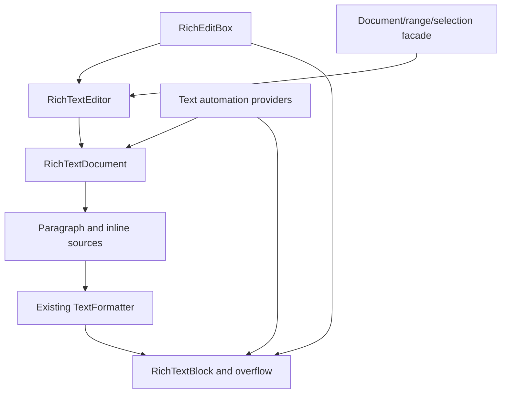

# Using and extending the rich text implementation

The implementation uses FerroUI's existing object, property, document-inline,
text-formatting, input, clipboard, dispatcher and automation contracts. This guide
describes the implemented architecture and its public Rust entry points. The
exact upstream member dispositions are in [API-MAP.md](API-MAP.md); missing native
members remain pending there and in [DEVIATIONS.md](DEVIATIONS.md).

## Architecture and ownership



| Responsibility | FerroUI contract and implementation |
|---|---|
| Observable objects, inherited values, untyped markup | `Ref<T>`, `FerroObject`, `ferro_class!`, registered properties and ordinary markup metadata. |
| Document identity and structure | [RichTextDocument](../../../src/FerroUI.Controls/documents/rich_text_document.rs), shared BlockCollection/InlineCollection handles and existing Run/Span/Bold/Italic/Underline/LineBreak/InlineUIContainer types. |
| Durable edit state | [DocumentSnapshot](../../../src/FerroUI.Controls/documents/document_snapshot.rs) and [format patches](../../../src/FerroUI.Controls/documents/character_format.rs). Mutable feature/decoration values are copied when snapshots are taken. |
| Shaping and line layout | [RichTextSource/RichTextLayout](../../../src/FerroUI.Controls/rich_text_layout.rs) feed the existing formatter. Existing font selection, Unicode, bidi, shaping, glyph drawing and text-run APIs remain responsible for text layout. |
| Pagination and selection | [RichTextBlock](../../../src/FerroUI.Controls/rich_text_block.rs) owns a primary view; [RichTextBlockOverflow](../../../src/FerroUI.Controls/rich_text_block_overflow.rs) contributes further pages through weak links. |
| Editable state | [RichTextEditor](../../../src/FerroUI.Controls/rich_text/rich_text_editor.rs) owns history, selection, typing format, input limits and composition state over the same model. |
| Control integration | [RichEditBox](../../../src/FerroUI.Controls/rich_edit_box.rs) derives from the rich view and connects routed input, clipboard, caret and the [input-method client](../../../src/FerroUI.Controls/rich_edit_box_text_input_method_client.rs). |
| Native text-object semantic services | [RichEditTextDocument/Range/Selection](../../../src/FerroUI.Controls/rich_text/rich_edit_text_document.rs) expose typed operations over the same editor; this is separate from the unavailable native TOM ABI. |
| Accessibility | [Portable text providers](../../../src/FerroUI.Controls/automation/provider/i_text_provider.rs) and [range providers](../../../src/FerroUI.Controls/automation/provider/i_text_range_provider.rs) use the same document/geometry; the [Windows bridge](../../../src/Windows/FerroUI.Win32/automation/automation_node_text.rs) handles native marshalling. |

The primary view owns the logical content. Overflow links and back references are
weak, and linking rejects cycles or a second owner. A model cannot be attached to
two unrelated primary views at once. For independent views, create independent
models from a snapshot. An embedded control is still the same control in that
snapshot, so copying it does not make simultaneous visual ownership valid.

Formatting and editing callbacks copy values out of interior mutable storage
before raising notifications. Document batches collect changes into a revision;
live pointers follow the ordered edits, and reentrant subscribers receive ordered
notifications. The tests for these boundaries are in
[rich_text_document_tests.rs](../../../src/FerroUI.Controls/documents/rich_text_document_tests.rs).

## Construct a rich document

```rust
use ferroui_base::media::FontWeight;
use ferroui_controls::RichTextBlock;
use ferroui_controls::documents::{Hyperlink, Paragraph, Run, Span};

let view = RichTextBlock::new();
let paragraph = Paragraph::new();
paragraph.inlines().add(Run::with_text(Some("Read ")));

let emphasis = Span::new();
emphasis.set_font_weight(FontWeight::Bold);
emphasis.inlines().add(Run::with_text(Some("formatted text")));
paragraph.inlines().add(emphasis);
paragraph.inlines().add(Run::with_text(Some(" and ")));
paragraph.inlines().add(Hyperlink::with_text(
    "open the project",
    Some("https://github.com/wieslawsoltes/FerroUI"),
));
view.blocks().add(paragraph);
```

Collections are shared handles. Keeping `let blocks = view.blocks()` and adding
to `blocks` changes the view's document; it does not mutate a detached copy.
Block/paragraph and inline ownership is validated during document operations.
Use `InlineUIContainer::with_child(control)` for an embedded control. The control
participates in ordinary FerroUI measure/arrange and is represented by one object
replacement character in the text coordinate system.

The ordinary document classes are registered for XAML. Content remains a
structured document rather than being converted to plain text by the loader:

```xml
<RichTextBlock FontSize="18" TextWrapping="Wrap">
  <Paragraph>
    A <Bold>formatted</Bold> paragraph with
    <Hyperlink NavigateUri="https://github.com/wieslawsoltes/FerroUI">a link</Hyperlink>.
  </Paragraph>
  <Paragraph>Another paragraph.</Paragraph>
</RichTextBlock>
```

The loader's normal whitespace rules still apply. Put intentional spaces in the
text and use adjacent tags when testing structure independently of whitespace.
The implementation does not bypass the regular runtime/compiled markup system.

## Linked columns and page geometry

```xml
<Grid ColumnDefinitions="*,*" ColumnSpacing="20">
  <RichTextBlock x:Name="FirstColumn"
                 Height="240"
                 TextWrapping="Wrap"
                 OverflowContentTarget="{Binding #SecondColumn}">
    <Paragraph>Content is laid out into the first column and continues in the next.</Paragraph>
  </RichTextBlock>
  <RichTextBlockOverflow x:Name="SecondColumn" Grid.Column="1" Height="240" />
</Grid>
```

Continuation includes the formatter break state. The existing
[TextLineBreak::fork](../../../src/FerroUI.Base/media/text_formatting/text_line_break.rs)
preserves the resolved shaping/bidi continuation when a following column has a
different width. Changes to text, formatting, width or an overflow target rebuild
the affected page inputs; selection remains associated with document offsets.

`hit_test_text_position`, `get_rects_for_range`, `line_metrics`, `content_start`,
`content_end` and `text_view_for_position` expose the same formatted view used for
drawing. Querying geometry does not change the selection. Geometry needs measured
and arranged content; the portable automation layer reports an explicit error
when no usable visual geometry exists.

Native line breaking, pixel output, every formatting option and all incremental
cache behavior are separate conformance targets. Reusing the formatter avoids a
second text engine, but does not prove identical native engine output.

## UTF-16 coordinates and live ranges

Public rich document positions count UTF-16 text. For `a😀b`, scalar boundaries
are `0`, `1`, `3`, and `4`. An edit at offset `2` would split the surrogate pair
and is rejected. Paragraph boundaries contribute LF; inline controls contribute
U+FFFC. Native synthetic element-open/close markers are not exposed as text.

`TextPointer` holds a weak document reference and an offset/gravity pair. Gravity
determines whether an insertion at that offset leaves the pointer before or after
the inserted text. Batched edits preserve the order of each position adjustment.
Detached/dropped documents make weak pointers unavailable. TextPointer character
rectangles are shaped insertion/caret rectangles using the requested direction as
affinity, which is an explicit adaptation of native structural geometry.

`RichEditTextRange::get_clone()` creates an independent live range. A range
operation changes that range; selecting it is a separate operation. A selection
is directed, with anchor and active endpoints, while a content range is normalized
for slicing and replacement.

## Text highlighters

Highlighters describe visual ranges without changing the document's formatting
or edit revision. `TextHighlighter` owns solid foreground/background brush values
and a shared range collection. The Rust range value is `TextHighlightRange`;
its markup name remains `TextRange`.

```rust
use ferroui_base::media::Brushes;
use ferroui_controls::documents::{TextHighlighter, TextHighlightRange};

let highlight = TextHighlighter::new();
highlight.set_background(Some(Brushes::yellow()))?;
highlight.ranges().add(TextHighlightRange::new(0, 5));
view.text_highlighters().add(highlight);
```

```xml
<RichTextBlock.TextHighlighters>
  <TextHighlighter Foreground="Black" Background="#FFFFDB80">
    <TextRange StartIndex="0" Length="10" />
  </TextHighlighter>
</RichTextBlock.TextHighlighters>
```

StartIndex and Length preserve signed source values. Inserting a range into the
collection copies that value; modifying a retrieved copy requires writing it back
through `set` to change the collection. Markup uses a temporary boxed value while
assigning the two fields, then copies it into the collection. Empty/invalid ranges
do not paint, and valid regions are clipped to the document.

Later highlighter layers replace both foreground and background with their own
brushes/defaults. Visual normalization occurs per layer before overlap resolution
so scalar boundaries do not change precedence or rewrite the public range value.
Brush/item changes invalidate the visual input through weak subscriptions.
The literal source overlap fixtures and value/lifetime tests are linked in
[TESTS.md](TESTS.md); native rendering and high-contrast conformance remain distinct.

## Editing and text-object services

```rust
use ferroui_base::media::FontWeight;
use ferroui_controls::RichEditBox;
use ferroui_controls::documents::CharacterFormat;

let editor = RichEditBox::new();
editor.set_text("Hello, rich text")?;
let text = editor.text_document();

text.edit_group(|text| {
    let word = text.get_range(0, 5)?;
    word.set_character_format(&CharacterFormat {
        font_weight: Some(FontWeight::Bold),
        ..Default::default()
    })?;
    word.set_text("Welcome")
})?;

text.undo()?;
```

`RichEditBox::document()` is the inherited shared model.
`RichEditBox::text_document()` is the editing/service facade. Both use the same
document, selection, geometry and history. This naming distinction avoids
introducing a second editable model behind the control.

The editor enforces read-only and UTF-16 maximum-length policies, performs
grapheme-aware deletion, coalesces compatible typing, bounds undo storage and
clears stale history after external edits. A failed grouped edit restores the
prior snapshot/selection and does not create a partial undo unit. A successful
group creates one undo unit. Typing format is retained at a collapsed selection
until the caret moves.

Format patches distinguish “leave unchanged” (`None`) from explicitly clearing
a nullable field (`Some(None)`). Range queries return `TextFormatValue::Uniform`
or `Mixed`. A mixed result is not silently converted to one run's format. Patch
fields use FerroUI font/brush/decoration values and layout distances; native TOM
points, effect flags and unrepresented fields need explicit conversion or work.

The Rust facade provides Character, Word, Sentence, Paragraph and Document units.
Character means a grapheme cluster; it does not preserve native TOM's separate
Character and Cluster units. Native Story is represented by this one document.
Search supports forward/backward and whole-word options with Unicode lowercase
mapping and preserved UTF-16 offsets; it is not a locale collation or full case
folding implementation. Unsupported native units/options remain in the exact API
inventory.

Use a surrounding `ScrollViewer` with a finite height for an editable viewport.
Caret and selection operations use framework bring-into-view. The control does
not host `WinUIEdit.dll` or depend on an additional native windowless text engine.

## RTF and clipboard

```rust
use ferroui_controls::documents::DocumentSnapshot;
use ferroui_controls::rich_text::{RtfReader, RtfWriter};

let snapshot = DocumentSnapshot::from_text("Unicode: café 😀");
let rtf = RtfWriter::write(&snapshot)?;
let decoded = RtfReader::read(rtf.as_bytes())?;
assert_eq!(decoded.text(), snapshot.text());
```

The [RTF codec](../../../src/FerroUI.Controls/rich_text/rtf.rs) supports its RTF1
subset: groups/escapes, Unicode fallback and Windows-1252 bytes, font/color tables,
supported character formatting, paragraph metrics, and hyperlink/bookmark/target
fields. Native OLE/pictures, tables/lists, additional code pages and unsupported
format representations return explicit errors. The native stream ABI and every
TextGetOptions/TextSetOptions flag are not supplied by the codec.

Default reader bounds are 16 MiB of input, nesting depth 128, one million parsed
tokens and 8 Mi UTF-16 text units. `read_with_limits` permits a caller to choose
tighter bounds. A syntactically accepted RTF group is not proof that all its
content features are supported; unsupported required content is rejected.

[RichTextTransfer](../../../src/FerroUI.Controls/rich_text/rich_text_transfer.rs)
offers an exact in-process snapshot and, when encodable, platform RTF formats
alongside plain text. Embedded controls retain identity in in-process transfer;
plain text remains available to external applications when the rich snapshot has
no supported RTF representation. Import prioritizes the in-process snapshot,
then advertised RTF, then plain text. Malformed/unsupported advertised RTF returns
an error rather than silently flattening it.

Clipboard actions are asynchronous through the existing framework transfer
contracts. Copy captures the fragment before awaiting the platform. Paste checks
the captured document/revision/selection before applying a delayed result. Rich
run formatting survives casing and single-line policy transformations. The
control exposes edit/clipboard failures to callers for normal application status
handling.

## Input methods and composition

The input-method client exposes committed surrounding text and UTF-16 selection
separately from the preview shown by a composition. Repeated previews replace
the prior preview. Cancel restores the original rich content/selection; commit
produces one undo unit. An external edit prevents cancellation from restoring a
stale snapshot over the changed model.

Input scope and prediction settings are passed to existing backend options.
They do not implement native proofing, dictionary prediction, handwriting or
candidate-window services. Real platform composition, cancellation and focus
flows remain separate tests from the deterministic control suite. Native event
ordering and cancellable SelectionChanging are recorded as remaining differences.

## Text accessibility

Both rich view and rich editor peers expose `ITextProvider`; the editor also
retains `IValueProvider`. The portable service implements the six Text provider
operations and eighteen TextRange operations over live weak model ranges. It
handles single selection, embedded controls, text search, formatting search,
range movement, geometry and text/selection notifications.

UI Automation has seven units: Character, Format, Word, Line, Paragraph, Page and
Document. Format boundaries merge equal effective runs but stop at semantic link
and embedded-control boundaries. Line falls back to Paragraph when the document
is not completely laid out; Page falls back to Document without a complete
multiple-page overflow chain. These are separate from the five TOM-facade units.

Sixteen attribute identifiers have typed handling, including font, color,
read-only/visibility, decoration/baseline, alignment and indentation values.
Mixed and NotSupported are values distinct from provider failures. Native font
size/paragraph metrics are converted to typographic points at this boundary;
unsupported brushes or attributes return NotSupported. The supported identifiers
do not imply implementation of every native style or hidden-text feature.

The Windows bridge dispatches to the UI thread and marshals native BSTR,
SAFEARRAY, VARIANT and HRESULT values. Range comparison accepts canonical
same-backend COM identities and checks document/owner compatibility. Root-space
portable geometry is transformed to native screen coordinates at the boundary.
Native tests are linked separately from portable tests; compilation alone is not
a Windows accessibility-client run.

Text2/caret/annotation, TextEdit/TextChild, additional attributes, dedicated
hyperlink peers and native text bridges on other backends remain pending. See
RT-I10 and RT-P05, and the exact pending member list in [API-MAP.md](API-MAP.md).

## Extending the port

For each new contract, read the pinned source or external public definition,
implement it through the existing FerroUI API, and add behavior tests that would
fail for the previous behavior. Add exact target/test/deviation evidence to
`mapping.json`, then regenerate the reports with the inventory script. Keep the
source file partial until all its relevant members and deviations have been
reviewed. `reuse_candidate`, `reference`, source-map checks and a growing test
count are never substitutes for a completed native behavior audit.
